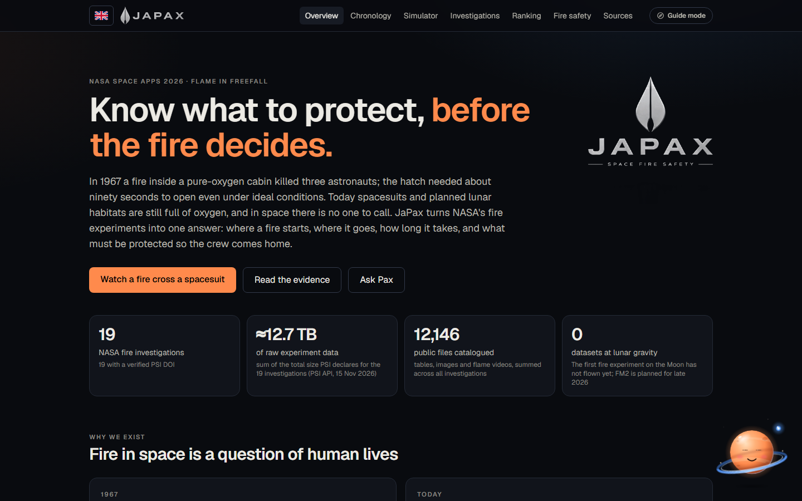
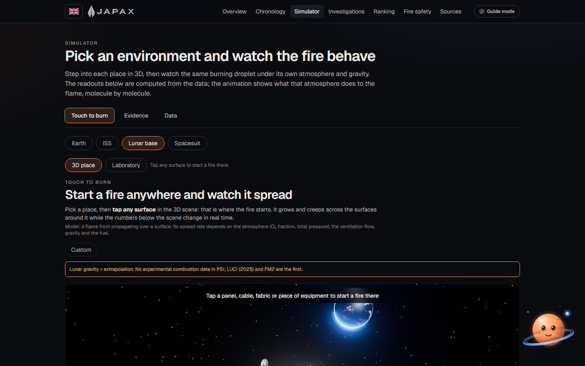
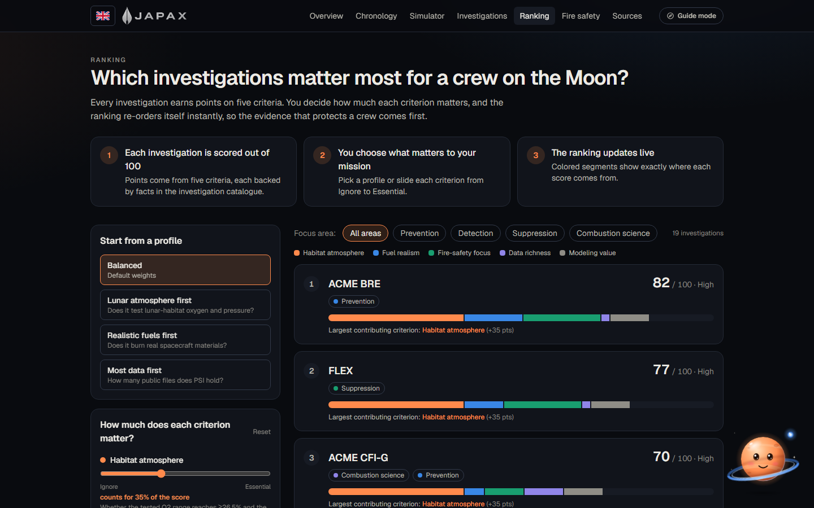
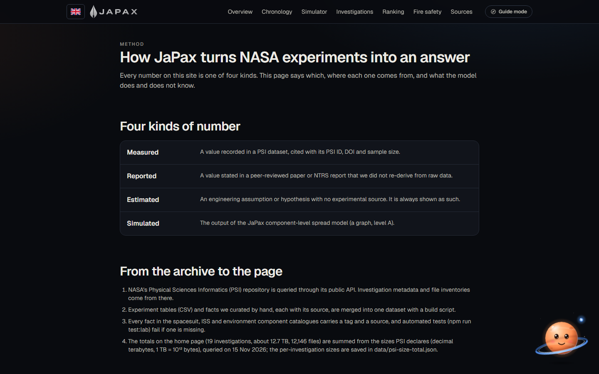

# JaPax

**Know what to protect, before the fire decides.**

JaPax turns NASA's microgravity fire experiments into clear, cited answers for spacesuits, ships and lunar bases: where a fire starts, where it goes, how long it takes, and what must be protected so the crew comes home.

**Live site: https://japax.vercel.app** (English and Spanish)

Built by two people for the **NASA Space Apps Challenge 2026** (Seville), challenge *Flame in Freefall: AI-Powered Fire Safety Insights from Microgravity Combustion Data*.

| | |
|---|---|
|  |  |
|  |  |

## Why it exists

In 1967 a fire in a pure-oxygen cabin killed three Apollo 1 astronauts; the three-piece hatch needed about 90 seconds to open even under ideal conditions. Today spacesuits (100% O₂ at 4.3 psi) and planned lunar habitats (about 30% O₂ at 10.2 psi or less) are still rich in oxygen, and in space there is no one to call. NASA has run fire experiments in microgravity for decades, but the results sit in tables only specialists can read, and **its archive holds zero datasets at lunar gravity**.

JaPax makes that evidence readable, and says out loud where it stops.

## What you can do on the site

| Page | What it does |
|---|---|
| **Overview** `/` | The story, the key numbers, the atmospheres nobody has tested, and the mishaps that shaped the requirements. |
| **Chronology** `/history` | 31 dated milestones (incidents, experiments, hardware, spinoffs), each with its source. |
| **Simulator** `/simulator` | *Touch to burn*: tap any part of a 3D spacesuit, the ISS, a lunar module or an Earth site and watch a fire spread between components, with protective measures, rupture warnings and a results window you can download as CSV or text. *Evidence* lists the measured spread rates. *Data* explores the experiment tables. |
| **Investigations** `/explorer` | The 19 NASA PSI investigations with conditions, findings, sensors, sources and DOIs. Filter, search and compare up to three. |
| **Ranking** `/dashboard` | Which investigations matter most for a lunar habitat, with weights you control, plus a coverage matrix by environment. |
| **Fire safety** `/safety` | What the data supports for prevention, detection, spread limitation and extinguishment, and what is still unquantified. |
| **Ask Pax** `/ask` | Ask questions in plain language. Answers show a headline, key numbers, a chart of real data, cited evidence, gaps and confidence. |
| **Method** `/methodology` and **Glossary** `/glossary` | How every number is labelled, how the model computes spread, and what each acronym means. |
| **Sources** `/references` | Every dataset, paper, library and 3D model, with DOI or NTRS id. |
| **Demo** `/demo`, **About** `/about` | A short film starring Pax, and the team. |

## Principles

- **Verified, never invented.** Every value comes from a cited source (PSI, NTRS, NASA fact sheets). Anything unverified is marked as pending.
- **Four kinds of number**, always labelled: *measured* (recorded in a PSI dataset), *reported* (stated in a paper), *estimated* (an assumption with no experimental source) and *simulated* (output of the JaPax model).
- **Honest about gaps.** Everything lunar is an extrapolation until LUCI (NTRS 20250010653) and FM2 publish results.
- **A model is not a test.** The simulator ranks what to protect first; it does not certify a design.

### A result you can reproduce

In the component model of the spacesuit, a fire that starts in the upper garment reaches the oxygen tank in 58 s and the tank bursts at 2 min 13 s; shielding the tank turns 6 bursts out of 6 fires into 1. These are **simulated** values built on a spread rate NASA **measured** on thin fabric (1.8-2.6 mm/s, SAFFIRE I-III, NTRS 20180005168); the scaling factors, the component layout and the rupture window are **estimates** and are labelled as such. Run it yourself in the simulator.

## Data

19 NASA PSI investigations, 12,146 public files and about 12.7 TB of declared raw data. See [docs/DATA.md](docs/DATA.md) for the full table (PSI ID, DOI, files, size), where each file in `data/` comes from, and the known gaps.

```
scripts/fetch-psi.mjs        -> data/psi/PSI-XX.json            (public PSI API, no key)
data/curated.json            -> hand-curated facts, each with its source
scripts/build-data.mjs       -> data/investigations.v2.json     (what the app reads)
scripts/build-lab-data.mjs   -> data/lab.json                   (experiment tables)
```

## Run it locally

```bash
npm install
cp .env.example .env.local     # optional: add ANTHROPIC_API_KEY for live Ask Pax answers
npm run dev                    # http://localhost:3000
```

| Command | What it does |
|---|---|
| `npm run build` | Production build. |
| `npm run type-check` | TypeScript check. |
| `npm run test:lab` | 90 automated tests of the component engine, the catalogues (every fact must carry a tag and a source), CSV export, run records and translations. |
| `node scripts/build-data.mjs` | Rebuilds `data/investigations.v2.json`. |

Without an API key, Ask Pax answers in *evidence mode* from the computed data. Deployment notes: [docs/DEPLOY.md](docs/DEPLOY.md).

## Project layout

```
app/          pages (Next.js App Router), sitemap, robots, Open Graph image, 404
components/   UI, the 3D scenes and the component panel
lib/          the spread engine, scoring, translations, the Ask Pax logic
data/         PSI metadata, curated facts, experiment tables, component catalogues
scripts/      data fetch and build scripts
tests/        node:test suites (npm run test:lab)
docs/         data guide, research notes, the 7-slide deck, screenshots
public/       3D models, textures, brand assets, the About video
```

## Use of AI

- **Ask Pax**: when an API key is set, free-form answers are narrated by Anthropic's Claude (`claude-sonnet-5-5`), grounded in the JaPax evidence base; the key numbers and charts shown come from computed data. Each answer shows whether it came from AI or from evidence mode.
- **Pax and the About video** carry a "Made with AI" mark where they appear.
- **Development**: the code was written by the team with AI coding assistance (Claude Code).

## More in this repository

- [docs/DATA.md](docs/DATA.md): data guide.
- [docs/COMBUSTION-RESEARCH-EN.md](docs/COMBUSTION-RESEARCH-EN.md): how fire burns, oxygen and other oxidizers, partial gravity (supporting research built only from the PSI data here).
- [docs/JaPax-7-slides.pptx](docs/JaPax-7-slides.pptx): the 7-slide presentation.
- [docs/TODO-PRE-SUBMISSION.md](docs/TODO-PRE-SUBMISSION.md): open items of the third-party license and attribution audit.
- [CLAUDE.md](CLAUDE.md): project context used by the AI coding assistant (in Spanish).

## Team

- **Jaime Alcina** ([@Jalcina](https://github.com/Jalcina)): studying Multiplatform Application Development.
- **Pablo Triguero** ([@ptricha](https://github.com/ptricha)): studying Computer Engineering, specialising in Data Science.

## License

Original code and design are released under the [Apache License 2.0](LICENSE) (see [NOTICE](NOTICE)). NASA data (PSI / NTRS) is public and is **not** covered by this license. JaPax is an independent project, not affiliated with or endorsed by NASA.
